

  <a href="https://faytonn-portfolio.vercel.app"></a>

  <a href="https://faytonn-portfolio.vercel.app">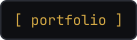</a>
  <a href="https://linkedin.com/in/fativali">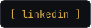</a>
  <a href="https://faytonn-portfolio.vercel.app/FatimaValiyeva_CV.pdf">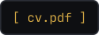</a>
  

  Software engineer in Prague, working across backend, infrastructure and AI. 
  Happiest building <b>tools other engineers rely on</b>, and learning by shipping.

 


**Apple** · Software Engineer Intern, CoreOS · Mar 2026 – Sep 2026 · Prague
- Built and owned an internal engineering-health platform (Django, React, PostgreSQL) scoring 2,500+ repositories on 45 static and AI-based checks across 6 quality dimensions.
- Designed the evaluation pipeline and 16 integrations, cutting 375 hours of manual assessment to a 3–4-hour automated run.
- Adopted across CoreOS after the internship; teams now track their repository-health scores against a 100% target set by engineering leadership.

**HP** · Software Systems Engineer Intern · May 2025 – Mar 2026 · Prague
- Built and operated a production Kafka pipeline on Kubernetes (with Schema Registry) collecting telemetry from 32+ factory servers across HP’s global laptop production of 60M+ devices a year, used to trace units and find defect causes.
- Automated ksqlDB and connector deployments across dev, integration and production with Ansible, cutting setup from about 30 to 2 minutes.
- Kept it secure and reliable: custom Kafka Connect images, schema-mismatch and failed-record fixes, Harbor-reported vulnerabilities remediated.

**TeskUp** · Backend Developer & Team Lead · May 2025 – Mar 2026 · Baku (remote)
- Owned backend architecture for an EdTech platform (ASP.NET Core, EF Core): auth, bookings, payments, course access; led a 4-person team and reviewed every PR.
- Built tools to flag paid bookings with missing enrollments, and used AI-assisted triage to find duplicate support reports and route issues to the right team.

 


  <a href="https://github.com/faytonn/relayroom"></a>
  <a href="https://github.com/faytonn/modelmux"></a>

  <a href="https://github.com/faytonn/BookIt">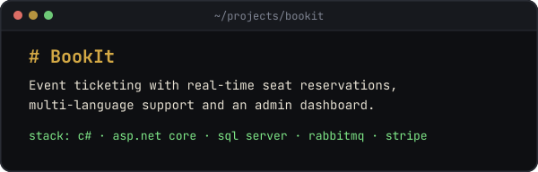</a>
  <a href="https://github.com/faytonn/webhook-fortress"></a>

RelayRoom is live at <a href="https://relay-room.com">relay-room.com</a>

 


   
  

  <b>Seat of learning:</b> Czech University of Life Sciences Prague, BSc Informatics (2025 – 2028) · previously Charles University, BSc Computer Science 
  <b>Tongues:</b> Azerbaijani · English · Turkish · Russian · German · Czech 
  <b>Beyond the walls:</b> tennis · kickboxing · climbing · electric guitar · sketching · hiking · karting · hackathons

 

