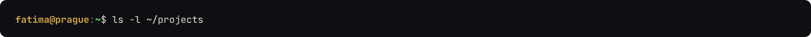
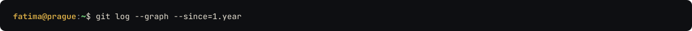

  
  
  

  
  

  
  

<picture>
  <source media="(prefers-color-scheme: dark)" srcset="https://raw.githubusercontent.com/faytonn/faytonn/output/snake-dark.svg">
  <source media="(prefers-color-scheme: light)" srcset="https://raw.githubusercontent.com/faytonn/faytonn/output/snake-light.svg">
  
</picture>

Most of my work lives in private repos.

